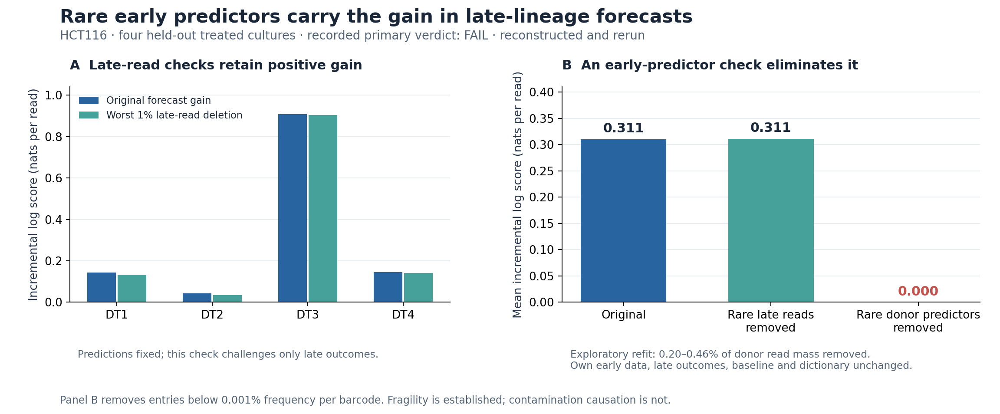

# A positive lineage forecast depends on rare predictor reads

**Nonclinical, unreviewed computational research. The recorded primary
robustness gate fails.** Early barcode measurements from other HCT116
cultures improve forecasts of each culture's later population, but the
increment disappears when a small tail of donor predictor measurements is
removed. A separate adverse check on later outcomes remains positive.

This contribution is a **fresh reconstruction and rerun**. The earlier local
repository and exported files were unavailable when publication resumed.
The earlier numerical results were known while reconstructing the code.
They were not inserted into the analytical outputs or used to change the
specified model. Newly retrieved input bytes and two mathematical
implementations reproduce the main reported numbers. We do not claim
recovery of the old commits or logs, a new blinded test, or biological
replication. [RECONSTRUCTION.md](RECONSTRUCTION.md) records this distinction.

The most informative intervention holds own-culture early measurements,
all later observations, baseline predictions and the barcode dictionary
fixed. Removing donor P1 entries below frequency `1e-5` excludes only
**0.197959–0.457818%** of each donor's early read mass. Every nested fit then
selects zero donor contribution, and all four incremental gains become zero.
The result identifies sensitivity of this specified fitted predictor;
technical spillover is a plausible explanation, not established causation.

[Analysis specification](PROTOCOL.md) · [Source audit](SOURCE_AUDIT.md) ·
[Mathematical proof](PREDICTOR_CONTAMINATION.md) ·
[Aggregate manifest](../../results/barcode-lineage-memory/run-20261128/manifest.json)

## Question and source

[Whiting et al. (2025)](https://doi.org/10.1038/s41467-025-59479-7) tracked
barcoded colorectal cancer cultures during repeated 5-fluorouracil exposure.
HCT116 and SW620 each supplied four treated cultures from their respective
expanded barcoded parent. Their published study already investigates clonal
resistance patterns, population dynamics and phenotype switching. Repeating
those broad observations would not establish a new discovery.

The present question is narrower: **does another treated culture's P1
distribution improve a held-out culture's P2 forecast beyond a tuned
forecast using its own P1?** The contribution is this quantitative benchmark,
the contrasting predictor/outcome sensitivities, and an explicit explanation
of why the sensitivities can disagree. Historical priority is not claimed.

The publisher's Supplementary Data 2 contains 13,962 HCTbc and 688,439 SW6bc
barcode rows, each with P1 and P2 counts for DT1–DT4. These are amplified
sequencing reads, not independent cells. All 702,401 released rows were
included in source preparation. The fresh workbook SHA256 and both canonical
count/identifier hashes match the earlier recorded pins.

P1 occurs after treatment has begun: the source reports day 67 for HCTbc and
day 37 for SW6bc. The inspected processed release does not supply complete
parental POT and untreated CO barcode distributions. Consequently the model
does not adjust for pretreatment abundance or untreated drift. No genetic
resistance mechanism, induction fraction or switching rate is identified.

## Forecast and validation

The primary dictionary includes every lineage seen in any P1 sample. All
remaining P2 observations are collapsed to `OTHER_UNSEEN`, which is retained
even when empty. HCTbc has 11,721 individually represented lineages plus this
category. This is P1-only support construction within the authors' already
filtered release; the unrecovered complete filtering history prevents
certifying independence from every raw-data outcome-dependent decision.

Each early vector is smoothed as `(1-delta)*p + delta/K`, with primary
`delta=1e-4`. If x is the target's early distribution and z the equally
weighted mean of eligible early donors, the forecasts are

\[
q_{0i}(a)=\frac{x_i^a}{\sum_j x_j^a},\qquad
q_{1i}(a,b)=\frac{x_i^a z_i^b}{\sum_j x_j^a z_j^b}.
\]

Both models tune the sharpening exponent over `a={0.5,1,1.5,2,3,4}`. The
augmented model also considers `b={0,0.25,0.5,1,2}`, including the baseline.
For each outer held-out culture, three inner folds tune parameters using
only the other cultures' P2 observations. Each inner donor set excludes both
its inner target and the outer target. The selected model then predicts the
outer P2 using its own P1 and the other three P1 donors. Cultures receive
equal weight regardless of sequencing depth.

The score gain is `sum(p2*log(q1/q0))`: nats per read of the evaluated
empirical distribution. Its exponential is a geometric probability ratio,
not classification accuracy or a fraction of resistance explained. Four
related cultures do not support read-level biological standard errors or
barcode-bootstrap biological confidence intervals. We report every fold
and descriptive sensitivities without a biological p-value.

## Primary result: positive forecasts, failed robustness gate

Every HCTbc primary fold selects baseline `a=1` and augmented
`(a,b)=(1,0.25)`. The mean gain is **0.3106646962 nats/read**.

| Held-out culture | Baseline log score | Augmented log score | Gain | Lower gain after adverse 1% outcome-mass deletion |
| --- | ---: | ---: | ---: | ---: |
| DT1 | −4.082214228 | −3.937971750 | +0.144242478 | +0.132457906 |
| DT2 | −4.692989677 | −4.650449032 | +0.042540644 | +0.034825963 |
| DT3 | −4.853436517 | −3.944052477 | +0.909384041 | +0.904232937 |
| DT4 | −4.220940844 | −4.074449223 | +0.146491621 | +0.141340892 |
| Equal-culture mean | | | **+0.310664696** | **+0.303214425** |

The recorded descriptive conjunction requires mean gain above 0.01, positive
gains in every culture, survival of a `1e-3` abundance-floor complete refit,
and positive fixed-predictor 1% target-deletion lower gains. **The abundance
requirement fails:** every required-floor full fit selects `b=0`, yielding
zero incremental gain. Even the `1e-4` sensitivity removes under 1% of P1
mass and under 0.5% of P2 mass and produces the same zero gains. The verdict
is **FAIL**, preserved alongside the favorable unfiltered scores.

The outcome-only bound asks a different question. With forecasts fixed,
remove target probability mass with the largest per-category score gain
first, including fractional boundary removal. This gives a sharp lower
retained mean. At 1% deletion the lower mean is **+0.3032144247**, positive
in every culture. Target-only tipping masses range from approximately 10.16%
to 75.98%. These are mathematical sensitivities, not measured assay errors
or evidence that the predictor measurements are clean.

SW6bc supplies contrary evidence: all primary folds choose `a=2`, `b=0`,
giving zero incremental gain. Its `1e-3` abundance analysis is unavailable
because required samples become empty. Those samples are not dropped to
obtain a more favorable result. All smoothing and abundance sensitivities
are retained in [HCTbc.json](../../results/barcode-lineage-memory/run-20261128/HCTbc.json)
and [SW6bc.json](../../results/barcode-lineage-memory/run-20261128/SW6bc.json).

## Exploratory localization of the rare information

The primary frequency floor changes both observations and dictionary size.
The recorded A2 follow-up separates these effects by retaining the original
dictionary and smoothing cardinality, thresholding original barcode entries
before collapse, and repeating the entire nested fit.

| HCTbc comparison at per-barcode cutoff `1e-5` | Mean gain, nats/read | Selected donor contribution |
| --- | ---: | --- |
| Original primary data | +0.310664696 | `b=0.25` in all four |
| Donor P1 features only thresholded | **0.000000000** | `b=0` in all four |
| P2 outcomes only thresholded | **+0.311430924** | Positive incremental gains remain |



Donor-only filtering removes respectively 0.457818%, 0.346507%, 0.334113%
and 0.197959% of early source-culture read mass. Own-P1, all P2, the baseline
fit and dictionary remain unchanged. The larger donor cutoffs also give zero
gain. This isolates the dependence of the **specified fitted predictor** on
rare donor measurements. It does not show that every removed read is an
artifact, that real shared information is absent, or that no other predictor
could work.

Removing a small outcome tail challenges where score is accumulated;
removing a small predictor tail challenges the information used to construct
the forecast. The checks address different failure modes. Complete
[exploratory outputs](../../results/barcode-lineage-memory/run-20261128/HCTbc_exploratory.json)
preserve early-only, late-only, joint and donor-only modes at all three
declared cutoffs. The follow-up remains exploratory and was already known
when this reconstruction began.

## Temporal profile diagnostic and sequencing opportunity

For each home culture, A2 selects lineages abundant in its P1 (`>=1e-3`) and
rare in all other P1 (`<1e-4`). It compares each receiver's minor early profile
with a home-P1/home-P2 mixture. A deterministic barcode hash splits training
and evaluation halves. The diagnostic deliberately uses later measurements;
it is not a prospective forecast or an estimate of contamination fraction.

| Home culture | Selected lineages | Mean conditional gain, nats |
| --- | ---: | ---: |
| DT1 | 117 | +1.126195022 |
| DT2 | 141 | **−0.062092078** |
| DT3 | 158 | +3.710547131 |
| DT4 | 151 | +1.146660474 |
| Equal-home mean | | **+1.480327637** |

Three of four home means and 21 of 24 receiver-half scores are positive.
However, **nine evaluation halves contain only one occupied receiver
lineage**. Ten selected barcodes per half does not imply ten observed
lineages. Repeated point-mass profiles and shared cultures/libraries are not
independent biological replicates. Scores are nats per receiver read
conditional on its selected half, rather than whole-library primary scores.
Mixture weights compare shape and are not contamination rates.

The fresh source audit matches all eight HCTbc early/late sample titles to
unique ENA runs. Their first R1 headers all identify instrument run 418,
flowcell `HW5HLDMXX`, lane 1; an original submitted-file header agrees.
Six matched SW6bc headers identify run 419, `HW55GDMXX`, lane 1. Two SW6bc
late sample names remain unmatched. The initial retrieval failure and
successful bounded repeat are preserved explicitly in
[sequencing_provenance.json](data/sequencing_provenance.json). A matching
early/late first header can establish a shared sequencing run for those
records; it cannot establish that every read shares that provenance or that
reprocessing reproduces the filtered workbook. Earlier reported matches
are not inherited when a fresh prefix is unavailable.

The authors' Methods already acknowledge residual index hopping despite
unique dual indexes. Supplementary Note 1 section 4.3 chooses Hill order
`q=2` to reduce sensitivity to rare PCR/sequencing errors. Failure of this
new rare-read-sensitive predictor therefore does not invalidate their
high-frequency diversity analysis or full mechanistic model. Technical
spillover, ancestry, selection and recovery effects remain competing
explanations. See the [source audit](SOURCE_AUDIT.md) for exact locators,
current retrieval limitations and the missing raw-to-filtered crosswalk.

## Mathematical explanation

[PREDICTOR_CONTAMINATION.md](PREDICTOR_CONTAMINATION.md) proves a
three-category construction for the geometric forecast with fixed `a=1`,
`0<b<1`. With a sufficiently small predictor probability floor, arbitrarily
small positive donor contamination can create a finite apparent gain that
survives every target-only deletion budget below one.

For the explicitly **synthetic** values `w=0.2`, `m=1e-8`, `b=1/4`,
`epsilon=1e-4`, the clean forecast assigns approximately 0.199999802 to the
observed category; the contaminated forecast assigns 0.714295665. Its
increment is **1.272979607 nats**, while the clean increment is approximately
−0.000000990. The target is a point mass, so any deletion below one leaves
the normalized target unchanged. This is a logical counterexample, not an
experimental estimate or an explanation fitted to the barcode data.

For fixed minimum donor probability m, contamination fraction epsilon, own
predictor and exponents, the proof also gives the continuity bound

\[
\left|\mathbb E_p\log\frac{Q(z_\epsilon)}{Q(z)}\right|
\le b\log\left(1+\frac{\epsilon}{(1-\epsilon)m}\right).
\]

There is no claimed discontinuity at a fixed positive floor. The bound does
not cover refitting the nested procedure. The note states the order of
limits and a contamination-before-smoothing version explicitly.

## Reproduction and evidential limits

From the repository root:

```sh
python -m pip install -r requirements-dev.txt \
  -r research/barcode-lineage-memory/requirements.txt
python results/barcode-lineage-memory/run-20261128/reproduce.py --fetch
```

With an authenticated source cache already prepared, omit `--fetch`. To
check only saved outputs and code fingerprints:

```sh
python results/barcode-lineage-memory/run-20261128/reproduce.py --check-artifacts
```

The entry point reruns all primary and exploratory reports, the synthetic
examples and the independent probability-space verifier. It compares every
scientific field within declared floating-point tolerance, authenticates
canonical count/barcode contents, and refuses to overwrite checked-in
expected outputs. Source files stay untracked; CC BY-NC-ND source materials
are not relicensed by this repository. Matplotlib is needed only to rerun
`plot_results.py`, not for numerical reproduction.

The separate [verifier](verifier.py) independently builds support, computes
normalized powers and evaluates direct count-weighted log scores. It
reproduces both cell lines' primary and abundance-floor results, four HCTbc
`1e-5` interventions, and every HCTbc temporal diagnostic fold. The largest
observed discrepancy is below `7e-13`. Exact Fraction vertex calculations
check the adverse target bound; 80-digit Decimal fourth-root calculations
check the synthetic example. Tests cover held-out-label isolation, donor
exclusions, dictionary construction, threshold placement, sparse support,
predictor-only baseline preservation and source-content tampering.

These checks establish agreement of implementations, not source truth,
independent biological replication or external scientific review. Current
test results are reported in the PR; the missing earlier test logs are not
treated as fresh evidence. The [result summary](../../results/barcode-lineage-memory/run-20261128/summary.json)
compares newly calculated headline numbers with the earlier conversation
record and marks this explicitly as a known-result reconstruction.

## Next discriminating computation

Reconstruct complete parental POT and untreated CO counts from deposited raw
data, reconcile technical replicates and original filtering, and establish
read-level provenance across relevant libraries. Repeat a separately
specified prediction with controls and information isolated across sequencing
runs. This could distinguish starting-abundance/untreated-drift predictability
from treatment-associated information and test spillover directly.

That raw reconstruction is not included here. The present result is a
specific reproducible obstacle: a held-out forecast can survive an adverse
outcome check while its incremental gain disappears when a very small tail
of donor measurements is excluded.
